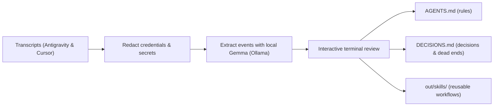

# RuleMine

[](https://www.python.org/downloads/)
[](https://ollama.com)

_Submission for the [Hacktoberfest Open-Source AI Challenge Week 3: Slow and Steady](https://dev.to/challenges/hacktoberfest-week3-2026-10-19)._

RuleMine is a local CLI tool that mines coding agent transcripts for repeated corrections, architecture choices, dead ends, and reusable workflows across your projects.

## Overview

Coding assistants start each conversation without memory of earlier sessions. They repeat mistakes you already corrected: choosing the wrong package manager, suggesting discarded libraries, or re-running failed approaches.

RuleMine extracts memory from past transcripts using an on-device Gemma model, so future agent runs inherit the context:



### Extracted events and destinations

| Event | What it catches | Output file |
| :--- | :--- | :--- |
| **Correction** | User steered the agent away from a habit or mistake (>= 2 times) | `AGENTS.md` |
| **Decision** | Architectural choice with an explicit reason | `DECISIONS.md` |
| **Dead end** | Approach that was tried, failed, and dropped | `DECISIONS.md` |
| **Skill** | Multi-step workflow repeated across sessions or projects | `out/skills/<name>/SKILL.md` |

Everything runs on `localhost`. Your code and transcripts never leave your machine.

## Quickstart

### Prerequisites

- Python 3.11 or newer
- [Ollama](https://ollama.com) installed and running locally
- The `gemma2:2b` model:

```bash
ollama pull gemma2:2b
```

### Installation

Clone the repository and install it in editable mode inside a virtual environment:

```bash
git clone https://github.com/Lillliant/CODE.git rulemine
cd rulemine
python3 -m venv .venv
source .venv/bin/activate
pip install -e ".[dev]"
```

### Verify setup

Test Ollama connectivity and JSON extraction:

```bash
rulemine smoke
```

### Basic workflow

1. Preview session discovery and secret scrubbing without model calls:
```bash
rulemine mine --since 7d --dry-run
```

2. Extract events from the past week:
```bash
rulemine mine --since 7d
```

3. Check database counts:
```bash
rulemine status
```

4. Group events into candidate drafts:
```bash
rulemine promote
```

5. Review candidates interactively:
```bash
rulemine review
```

6. Write approved items to repository files:
```bash
rulemine write --no-dry-run
```

## File structure

| Stage | Files | Responsibility |
| :--- | :--- | :--- |
| **Ingest & Privacy** | `adapters/`, `redact.py` | Reads Antigravity JSONL and Cursor SQLite logs; scrubs API keys and secrets |
| **Turn Processing** | `window.py` | Splits conversation turns into labeled token and character windows |
| **Inference & Cache** | `extract.py`, `store.py` | Calls local Gemma via Ollama; caches session hashes in SQLite |
| **Draft Promotion** | `promote.py`, `gitlink.py` | Clusters recurring events; attaches nearby Git commit hashes |
| **Output & CLI** | `render.py`, `models.py`, `cli.py` | Formats markdown files; manages Pydantic schemas; runs the Typer CLI |

## CLI commands and options

### `rulemine mine`

Scans agent transcripts and extracts events with local Gemma.

| Option | Description | Default |
| :--- | :--- | :--- |
| `--since` | Time window to scan (`7d`, `24h`, or `YYYY-MM-DD`) | `7d` |
| `--model` | Ollama model name | `gemma2:2b` |
| `--dry-run` | Scan and scrub without calling the model | `false` |
| `--workspace` | Filter transcripts by workspace directory | None |
| `--adapter`, `-a` | Transcript source: `antigravity`, `cursor`, or `auto` | `auto` |
| `--limit`, `-n` | Maximum number of sessions to process | None |
| `--quick`, `-q` | Fast mode: process top 3 sessions with fewer examples | `false` |
| `--timeout`, `-t` | Ollama socket read timeout in seconds | `180.0` |
| `--keep-alive` | Model keep-alive duration in memory | `30m` |
| `--continue-on-error` | Skip failing sessions and keep processing | `false` |
| `--no-filter` | Send all windows to model without heuristic gating | `false` |
| `--max-fewshots` | Few-shot examples in prompt | `2` |
| `--db` | Path to SQLite cache database | `out/rulemine.sqlite` |
| `--host` | Ollama server URL | `http://127.0.0.1:11434` |
| `--base-dir` | Custom base directory for transcripts | None |

### `rulemine status`

Shows counts for cached sessions, extracted events, and drafts in the database.

| Option | Description | Default |
| :--- | :--- | :--- |
| `--db` | Path to SQLite cache database | `out/rulemine.sqlite` |

### `rulemine promote`

Clusters extracted events into proposed rules, decisions, and skill candidates.

| Option | Description | Default |
| :--- | :--- | :--- |
| `--min-support` | Occurrences needed to promote a correction to a rule | `2` |
| `--min-skill-support` | Occurrences needed to promote a skill candidate | `1` |
| `--min-workspaces` | Distinct workspaces needed to promote a skill | `1` |
| `--min-decision-support` | Occurrences needed to promote a decision or dead end | `1` |
| `--require-reason` | Only promote decisions that include an explicit rationale | `false` |
| `--workspace`, `-w` | Filter events to a specific workspace directory | None |
| `--db` | Path to SQLite cache database | `out/rulemine.sqlite` |

### `rulemine review`

Starts an interactive terminal session to approve, reject, or skip proposed drafts.

| Option | Description | Default |
| :--- | :--- | :--- |
| `--kind`, `-k` | Filter review by draft type (`rule`, `decision`, or `skill`) | None |
| `--all`, `-a` | Approve all pending drafts without prompts | `false` |
| `--db` | Path to SQLite cache database | `out/rulemine.sqlite` |

### `rulemine write`

Writes approved drafts to project files. Runs in preview mode by default; pass `--no-dry-run` to write files.

| Option | Description | Default |
| :--- | :--- | :--- |
| `--rules` | Write approved rules to `AGENTS.md` | `false` |
| `--decisions` | Write approved decisions and dead ends to `DECISIONS.md` | `false` |
| `--skills` | Write approved skill drafts to disk | `false` |
| `--dry-run` / `--no-dry-run` | Preview changes without modifying files | `--dry-run` |
| `--sidecar` | Write rules to `AGENTS.rulemine.md` instead of `AGENTS.md` | `false` |
| `--out` | Output folder for generated skill files | `out/skills` |
| `--target-dir` | Directory containing `AGENTS.md` and `DECISIONS.md` | `.` |
| `--db` | Path to SQLite cache database | `out/rulemine.sqlite` |

### `rulemine smoke`

Smoke-tests Ollama structured JSON extraction with local Gemma.

| Option | Description | Default |
| :--- | :--- | :--- |
| `--model` | Ollama model name to test | `gemma2:2b` |
| `--host` | Ollama server URL | `http://127.0.0.1:11434` |
| `--timeout`, `-t` | Request timeout in seconds | `60.0` |
